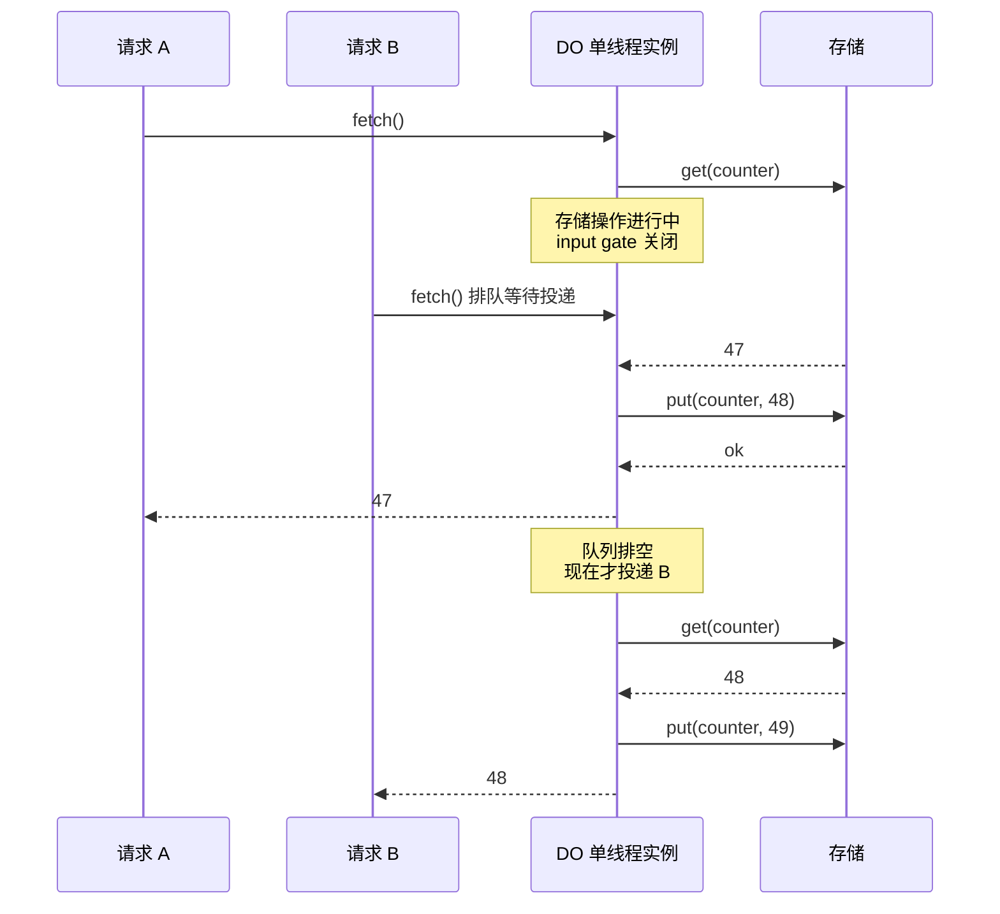
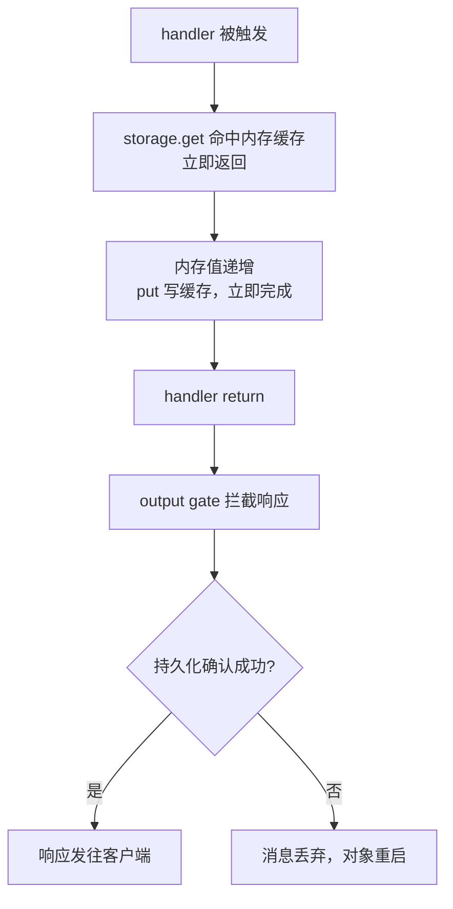

Cloudflare Workers 常被概括成「部署在全球边缘节点上的 JavaScript 函数」。这个说法只覆盖了执行位置，漏掉了真正决定编程模型的另外两件事：执行单元是什么形状，资源怎么拿到，以及状态放在哪。

展开这三件事之后，Workers 呈现出的不是「更快更便宜的 Lambda」，而是一套和容器时代不同的取舍：状态从「进程里」搬到「按名字寻址的对象里」，一致性从「数据库事务」搬到「单点权威 + 运行时门控」，运维从「编排」退回到「写绑定」。

<!--more-->

## 一、执行单元是 isolate，不是容器

Workers 运行时跑在 Cloudflare 全部 300 多个城市的机房里，每个请求落到离用户最近的那一台。运行时本身是开源的 workerd，底层是 V8——和 Chromium、Node.js 同一个引擎。

关键差异在隔离粒度。传统云函数的隔离单元是容器或虚拟机：一个进程、一套运行时、若干内存。Workers 用的是 V8 isolate，同一个进程里可以同时跑成百上千个 isolate，各自的堆内存完全隔离。Cloudflare 官方的说法是 isolate 的启动速度约为容器里一个 Node 进程的一百倍，启动时的内存占用低一个数量级；一个 isolate 可以处理多个并发请求，但始终是单线程事件循环。

这带来一个必须记住的推论：**isolate 不是你的进程**。模块级的顶层变量会在同一个 isolate 内的多个请求之间共享，但平台不保证下一个请求落到同一个 isolate，也不保证落在同一台机器、同一个城市。官方文档的直接建议是不要修改全局状态。

| | Workers | 容器 | 云函数 |
|---|---|---|---|
| 隔离单元 | V8 isolate | 容器 / 虚拟机 | 容器 |
| 部署位置 | 全球 300+ 机房 | 自选集群区域 | 通常自选区域 |
| 请求路由 | 平台按用户位置调度 | 需自建 LB / K8s Service | 区域入口 |
| 全局变量 | 请求间共享但不保证复用 | 进程存活期内有效 | 通常冷启动丢失 |
| 单实例内存 | 128 MB | 由机器决定 | 由配置决定 |

## 二、CPU 时间不等于墙钟时间

Workers 最反直觉、也最能决定应用形态的约束，是计费和限流都按 CPU 时间算，而不是墙上时钟。等待 `fetch()`、KV 读取、数据库查询都不计入 CPU 时间。

具体数值上，免费版每次 HTTP 请求 10 ms，付费版默认 30 s，可以在 `wrangler.jsonc` 里调到最多 5 分钟。Cloudflare 给的参考值是：平均 Worker 每次请求约消耗 2.2 ms CPU，做鉴权、服务端渲染或解析大 payload 的场景在 10 到 20 ms 之间。除 CPU 时间外还有几条硬约束：每个 isolate 128 MB 内存、单请求 6 个并发出站连接、10,000 个子请求（免费版 50 个）。

这组数字的正确读法是：Worker 应该把墙钟时间花在等 I/O 上，而不是烧在算东西上。一个转发 API 聚合、串行调用五个上游的 Worker，CPU 时间可能只有几毫秒，但墙钟跑了几百毫秒——这在 Workers 上既不违规也不计费。反过来，一个做图像编码或大 JSON 解析的 Worker 会很快撞上 CPU 上限，即使它看起来只跑了一瞬间。

撞上之后有两条出路：要么拆分请求，把计算摊到多次调用里；要么把状态和长计算搬进 Durable Objects 或 Workflows。托管平台给出的建议里，第一反应永远是「优化代码」和「把昂贵计算挪走」，而不是申请更高配额。

## 三、绑定：把基础设施下沉到资源级

传统服务里，数据库和缓存是运行期连上去的：

```go
db := mysql.Open(os.Getenv("DB_DSN"))
redis := redis.NewClient(...)
```

要自己管地址、凭证、连接池、服务发现、超时。Workers 里这件事被挪到了部署期：

```javascript
export default {
  async fetch(request, env, ctx) {
    const user = await env.USERS.get("123");
    return Response.json({ user });
  }
}
```

`env.USERS` 是一个绑定：在部署配置里声明好的 KV 命名空间，运行时直接以对象形式出现在 `env` 上。凭证不进入代码，也不需要出现在代码里。这一层同时也是安全边界——绑定把「这个 Worker 能碰哪些资源」写进了配置，而不是靠代码自觉。

选绑定类型其实就是选一致性模型，这一步选错后面全是补救：

| 绑定 | 语义 | 一致性 | 适合 |
|---|---|---|---|
| KV | 全球键值 | 最终一致，跨位置最长 60 s 以上 | 配置、白名单、缓存 |
| D1 | SQLite | 单写者，事务内一致 | 关系数据 |
| R2 | 对象存储 | 强一致 | 文件、图片 |
| Durable Objects | 状态 + 计算 | 强一致 + 可串行化 | 会话、房间、协调 |

KV 那一行的 60 秒值得单独强调。KV 的写入先落到中央存储，不会主动推给各地缓存；写入所在位置的读通常立刻可见，但官方明确说明这个行为不保证、不要依赖。其他位置要等本地缓存超时，可能 60 秒或更久。更容易踩的是**负查找也会被缓存**——「这个 key 不存在」这个结论本身会被缓存 60 秒，所以「先写后读同一 key」在 KV 上是不可靠的，写后读必须换到别的存储上。

## 四、Durable Objects：按名字寻址的权威实例

Durable Object 是 Workers 平台上唯一自带状态的执行单元。每个对象有一个全局唯一的名字，可以从任何地方被寻址；同一时刻该名字对应一个活跃实例；存储和计算部署在同一个位置。

```javascript
import { DurableObject } from "cloudflare:workers";

export class Room extends DurableObject {
  constructor(ctx, env) {
    super(ctx, env);
    // 初始化完成前不投递任何请求
    this.ctx.blockConcurrencyWhile(async () => {
      this.members = (await this.ctx.storage.get("members")) ?? new Set();
    });
  }

  async fetch(request) {
    const who = new URL(request.url).searchParams.get("who");
    this.members.add(who);
    await this.ctx.storage.put("members", [...this.members]);
    return new Response(`${[...this.members].join(", ")}`);
  }
}
```

从 Worker 侧调用时只拿到一个 stub，不产生请求，直到真的调用它的方法：

```javascript
const room = env.ROOM.getByName("room:1001");
const res = await room.fetch("https://internal/join?who=tom");
```

把房间、租户、会话这类实体做成「一个名字对应一个实例」，Actor 模型的形状就出来了：每个实例接收消息、在自己的单线程上下文里执行、访问自己私有的持久存储。Actor 模型在 Erlang、Elixir、Orleans 里都有成熟实现，Durable Objects 是把它做成了平台原语，而不是一个库。

这里和 Redis Cluster 的对照值得说清楚，因为两者都像「按 key 路由到固定位置」，但关键性质不同。

Redis Cluster 是**分片**：`CRC16(key) % 16384` 映射到槽，槽再映射到节点，不同槽的数据分布在不同节点上，同一个 slot 的并发访问由客户端保证不冲突。Durable Objects 是**单点权威**：`name` 映射到唯一一个活跃实例，同一对象在任一时刻只有一个线程在处理它，并发正确性由运行时保证而非客户端保证。所以 DO 不需要客户端做分片计算，也不需要考虑「我这个 key 会不会和别人撞在同一节点上被并发写」——因为这个冲突在平台层面被取消了。

代价是对象数没有硬上限但每个对象有容量和算力上限（存储最高 10 GB），热点对象不能像 Redis 那样靠加机器横向拆。所以它是「按实体切分」，不是「按数据量切分」。

### 生命周期决定计费

对象的状态机有五态：活跃在内存、空闲不可休眠、空闲可休眠、已休眠、非活跃。空闲 10 秒且满足条件（没有定时器、没有未完成的 I/O、没有在用标准 WebSocket API）后进入休眠，内存被丢弃但 WebSocket 连接保持；不可休眠时会在 70 到 140 秒空闲后被彻底驱逐，下次请求重新冷启动。

休眠的对象不计时长费用。计费按 GB-s 走，算法是「分配给它的 128 MB 内存 × 墙钟秒数」，即使几个实例共享同一 isolate 的内存也各按 128 MB 记。付费版每月含 400,000 GB-s，超出 $12.50 / 百万 GB-s；请求按 $0.15 / 百万计。用 WebSocket Hibernation API 可以在空闲期不收费，这是长连接场景下唯一重要的开关。

这条计费规则的实际后果是：不要用 `setInterval` 把对象钉在内存里，那等于按 GB-s 持续付费；能用 alarm 就用 alarm。

## 五、input gate 与 output gate

单线程听起来就等于没有并发，但 JavaScript 的 `await` 会交出执行权。考虑一个朴素的计数器：

```javascript
async function nextTicket() {
  const value = await this.ctx.storage.get("counter");
  await this.ctx.storage.put("counter", value + 1);
  return value;
}
```

两个请求并发到达时，都可能在第一个 `await` 处交错，都读到 47，然后都写出 48——两张一样的票。问题不是多线程同时执行，而是 await 边界上的事件交错。

Durable Objects 用两道门解决它。

**Input gate**：当一个存储操作正在进行时，对象除了该操作的完成事件以外不接受任何新事件，其余输入排队，直到对象既不执行 JavaScript 也不等存储操作。上面的交错因此被打断成 `A.get → A.put → B.get → B.put`，读-改-写序列不会被外来的请求切成两半。



**Output gate**：写操作确认之前，不发送响应、也不发送后续的出站 `fetch()`。于是一个不 `await` `put()` 的内存缓存写法也是安全的——内存里的值立即递增，函数立即返回，但外部要等到写入确认后才观察得到结果；写失败时消息被丢弃、对象重启，不会出现「外部收到成功、数据其实没落盘」。



两道门之外还有一层自动内存缓存：最近读写过的键留在对象所在进程的内存里，命中不走存储往返；连续多次写入会被合并而不是变成多次网络往返；存储操作严格按照发起顺序执行，而不是按完成顺序。所以 `put()` 在缓存命中时几乎瞬时完成，真正的持久化确认由 output gate 兜住。

这套机制替代掉的东西很明确：围绕每个读-改-写序列的显式锁、乐观版本号、事务回调与冲突重试。事务本身在 DO 里仍然可用，但 Cloudflare 明确把它列为不推荐路径——事务要额外协调、冲突时重试、回调可能被多次调用因而必须幂等，这些成本正是两道门想消除的。

也有绕不过去的边界。如果在**同一个事件**里主动并发启动两个读-改-写，input gate 没有任何新事件可以延迟，照样会交错；另外 `allowConcurrency`、`noCache`、`allowUnconfirmed` 三个选项可以显式关闭门控和缓存，代价是自行承担排序和持久化的风险。

## 六、Deno 并入之后，编程模型比运行时更重要

2026 年 10 月 9 日，Deno 团队整体并入 Cloudflare。消息本身只有一周，但把两件事放在同一张时间线上看更有意思。

Deno 团队在 8 月发布了 celld，一个用 Rust 写的 Workers 编程模型开源实现，只依赖对象存储做协调和持久化，一个二进制 + 一个桶就能跑分布式应用。而 Cloudflare 这边的短板恰好在这里：workerd 虽然开源，但它的 Durable Objects 只支持单实例，本地调试够用，规模化运行不行，Cloudflare 生产环境的路由是围绕几百个机房的自建基础设施设计的，自托管用户拿不到。

两边合到一起要解决的问题很清楚：让自托管的 Workers 成为一等公民。合并之后 Deno runtime 再维护一年（只发 bug 修复和安全更新），Deno Deploy 六个月后关停。

Ryan Dahl 自己的表述解释了为什么值得这么做。他把 Deno 之后的路径写成一条主线：Node.js 展示了纯异步 I/O 能带来什么，Deno 改善了写 JavaScript 的体验，但两者都没有改变开发者围绕运行时要自己拼装的东西——真正难的是网络化应用里的计算分发、状态协调、存储和扩缩容。他最后选择押注的是 Durable Objects 这个「分布式单例 + 本地关系库」的抽象。

也就是说，这笔交易验证的判断是：**执行环境（runtime）会趋同，编程模型才是差异所在**。workerd、celld、Node.js、Deno 在 V8 上的差别会越来越小，而「按名字寻址的单点权威实例 + 运行时门控」这套抽象能不能在 Cloudflare 之外跑起来，决定它最终是一个 API 还是一种范式。

对使用者的现实判断：短期把 Workers 当边缘请求处理层用，状态放 KV 和 D1，需要强一致协调的单体逻辑再上 Durable Objects；如果将来要迁出 Cloudflare，isolate 里不要依赖任何平台专有 API，DO 也只当接口用——这一层最有可能在合并后的开源运行时里保持语义一致。