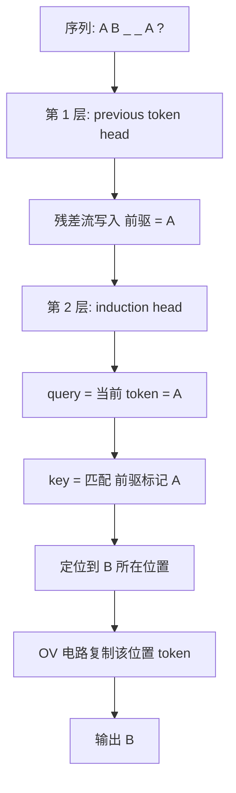
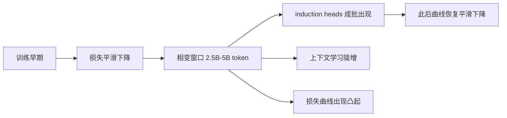

「涌现」是这两年大模型讨论里被用得最滥的词。它有时指能力随规模突然出现，有时指训练中某种结构自己长出来，有时又只是评测曲线上的一个陡坎——这三件事的机制完全不同，混着用会得出互相矛盾的结论。

数学家 Stephen Wolfram（Wolfram Research 创始人，Mathematica 与 Wolfram|Alpha 的作者）在 2023 年初的《What Is ChatGPT Doing… and Why Does It Work?》里，用括号语言做过一个能自己复现的实验：1 个注意力块的 Transformer 学不会平衡括号，2 个就能收敛。这大概是最小的一份「涌现」样本。下面按机制、测量和工程边界三层来看。

<!--more-->

## 一、三个混在一起的说法

| 说法 | 主张 | 证据状态 |
|---|---|---|
| 尺度涌现 | 能力在某个参数量或算力阈值上突然出现 | 现象确凿，解释有争议 |
| 训练相变 | 训练推进到某个时点，内部结构自行形成，伴随损失曲线突变 | 小模型上有因果证据，大模型上只有相关性证据 |
| 度量幻觉 | 「突然出现」是指标选的产物，换个连续指标就平了 | 在多个任务和模型族上可复现 |

Wei 等人 2022 年给大模型语境下的涌现下过一个操作性定义：能力在小模型中不可见、在大模型中出现，且无法通过外推小模型的趋势来预测；两个特征是锐利（sharpness）与不可预测（unpredictability）。这个定义描述的是现象，不是机制，而且特别容易被误读成「内部机制也跳变了」。后面几节分别处理这两件事。

## 二、一份能自己复现的涌现样本

Wolfram 的配置很小：

```text
Transformer（attention-only）
  特征向量维度 128
  注意力头     8
  注意力块     1 或 2
  词表         "("  ")"  "End"
  训练样本     语法正确的括号序列
```

三个观察：

1. 1 个注意力块时，网络学不到多少关于括号语言的东西。
2. 2 个注意力块时，学习过程收敛，但要在约 1000 万个样本之后；继续喂更多样本反而让性能变差。
3. 收敛后的网络约 40 万个权重。即使序列已经可以安全收尾，它仍给「)」15% 的概率——这必然导致括号不平衡。以最高概率补全逐渐变长的「(」序列，某个长度之前都对，之后开始出错。

第 3 点是后面所有讨论的伏笔：<strong>网络确实学会了括号语言的规律，但没有学会括号匹配的算法。</strong>

这个「一层不行、两层才行」的门槛，Anthropic 在[《A Mathematical Framework for Transformer Circuits》](https://transformer-circuits.pub/2021/framework/index.html)里独立测到过，并给出了机制解释。他们把极小的 attention-only Transformer 按层数拆开：0 层的模型直接建模 bigram 统计；1 层的模型等价于 bigram 与 skip-trigram（形如「A … B C」）的混合；到 2 层，模型开始用多个注意力头的组合实现复杂算法，其中最关键的一种叫 induction head。

induction head 完成的是这样一件事：

```text
序列:  A  B  ...  A  ?
                  ↑
             当前查询位置

输出:  B
```

它不查表、不检索，只靠两跳注意力在上下文里找到「上一次 A 后面跟的那个 B」。作者发现，这类头<strong>只在至少有两个注意力块的模型里出现</strong>。Wolfram 的括号实验和 Anthropic 的机制分析是两组独立的工作，都指向「层数是硬门槛」这件事。

括号实验的原文在 [Wolfram Blog（2023 年 2 月）](https://blog.wolfram.com/2023/02/14/what-is-chatgpt-doing-and-why-does-it-work/)，书籍版是 [What Is ChatGPT Doing… and Why Does It Work?](https://wolfram.com/books/profile.cgi?id=9846)（Wolfram Media，2023 年 3 月，112 页）。

## 三、能力在训练中途长出来

如果 induction head 是关键，那么它什么时候出现就成了可测的问题。Olsson 等人 2022 年在[《In-context Learning and Induction Heads》](https://arxiv.org/abs/2209.11895)里的答案是：它在一个很窄的训练窗口里成批出现，同一时刻，模型的上下文学习能力陡增。

他们分析了 34 个 decoder-only Transformer，覆盖 1–6 层的小模型直到 40 层、130 亿参数的全尺寸模型，结论有三条：

- 相变窗口大致在第 25 亿到 50 亿训练 token，对大模型相当于整个训练的前 1%–2%。超过 75% 的最终上下文学习能力在这个窗口内一次性获得。
- 损失曲线在这个窗口里出现一个凸起（bump）。准确说损失仍在下降，只是下降速率突变，在整体平滑下降的曲线上鼓出一个形状。论文的说法是，这是训练中唯一一处损失不再保持凸性的阶段。
- 1 层模型是明确的例外：既不形成 induction heads，也没有上下文学习的跃升，同样看不到那个凸起。

1 层模型这个例外，把「层数」和「涌现」直接绑在了一起。同一个任务、同样的数据、同样多的训练 token，唯一的变量是层数。

机制上的解释在残差流里。Anthropic 的框架把每层的输出看成往一条共享的「残差流」上叠加写入，于是后一层的头可以读取前一层的头写上去的东西，形成三种组合：

```text
残差流 r = 词嵌入 + 各层贡献的累加

第 1 层  previous token head
  OV 电路把「前一个 token 的身份」写进 r

第 2 层  induction head
  Q-composition   query = 当前 token 的 query + r 里的前驱信息
  K-composition   key   = r 中被上一层的 head 标记过的位置
  V-composition   value = 目标位置本身的 token 表示

induction 主要靠 K-composition 成立
```

一层为什么做不到，原因很直白：一层的 query 和 key 都从同一位置的残差流算出来。处理到序列末尾那个 A 时，这个位置知道「当前是 A」；而 B 所在的位置只知道「当前是 B」，那里没有任何信息说明「前一个 token 是 A」——因为还没有任何一层把这条信息搬过去。





这里有一处措辞上的克制值得注意：论文对不同规模给出的证据强度不同。小型 attention-only 模型上是因果证据——把 induction heads 消融掉，上下文学习能力会随之大幅下降；带 MLP 的小模型上是中等证据；全尺寸大模型上只有相关性证据，作者自己称之为「间接但相当有力的旁证」。把这三级混成一句「涌现机制已经被解释清楚了」，是常见但站不住的跳跃。

## 四、学会规律不等于掌握算法

回到括号。Wolfram 的观察在今天依然成立，而且被拆得更细了。2025 年 NeurIPS 上的一篇工作（[《Failure by Interference》](https://arxiv.org/abs/2507.00322)）在一批 124M 到 70 亿参数的模型上追这个问题，结论是：模型内部同时存在「可靠机制」和「缺陷机制」两类组件，两者各自独立地对最终输出投票，出错的原因是缺陷机制的影响压过了可靠机制。

关键细节是：可靠机制确实存在。论文报告，在某些模型里，单独一个注意力头的准确率比整个模型还高——正确的逻辑就在里面，只是被噪声淹没了。他们提出的 RASteer 方法先按跨子任务的稳定性给组件排名，再在推理时放大排名靠前组件的贡献，在平衡括号任务上把部分模型从 0% 提到接近 100%，在算术推理任务上最高提升约 20%。

还有一处结构性原因：前馈神经元的输出投影到固定的 token 集合，一个偏好「))))」的神经元几乎必然也偏好「)))」，这种「噪声式推广」模型自己过滤不掉。注意力头更灵活，所以放大注意力头的效果明显好于放大前馈神经元。

这解释了为什么「模型知道正确答案」和「模型给出正确答案」是两件事。涌现出来的是规律，不是算法；可靠地执行一个算法，需要的是外部约束。这也是为什么在要求绝对正确的任务上，靠得住的系统设计从来不是「让模型再努力一点」，而是叠加约束解码、生成后校验，或者干脆交给算法和工具去做。

## 五、涌现是真的，还是度量造出来的

上面讲的是机制。争论的另一面是：模型规模的曲线本身在不在骗人。

Schaeffer 等人 2023 年的[论文](https://arxiv.org/abs/2304.15004)给出了一个很锋利的论证。多数基准用 Accuracy、Exact String Match 这类非连续指标打分，而这类指标会把平滑的能力增长放大成断崖。数学上的机制再简单不过——五位数字的答案要求每一位都对，单 token 正确率是 50% 时全对率约 3%，80% 时约 33%，95% 时约 77%：

```text
单 token 正确率 p
五位答案 exact-match 准确率 = p^5

  p = 0.50   ->   3%
  p = 0.80   ->  33%
  p = 0.95   ->  77%
```

单 token 正确率从 50% 平滑涨到 95%，总共 45 个百分点；在 exact-match 曲线上看，却像是从「完全不会」到「基本全会」的跳变。论文在 GPT-3 家族上验证过：固定同一批模型输出，把指标从 Accuracy 换成 Token Edit Distance，曲线立刻变成平滑且可预测的改善；在视觉任务上，他们还能用刻意选择的阈值指标人为制造出从未被报告过的「涌现」。结论被表述为：对同一个任务、同一个模型族，研究者可以选一个指标造出涌现，也可以选一个指标消掉涌现。

这不等于否认涌现。论文本身留了口子：这里没有任何说法主张大模型不能表现出涌现能力，只是说那些能力究竟何时出现，很大程度取决于怎么量。反方向的证据同样存在——OpenAI 在 o1 的发布材料里给的是训练算力和测试算力上的平滑提升曲线，AIME 2024 上 GPT-4o 平均解出 12%，o1 单样本 74%、64 样本多数投票 83%、重排序 1000 个样本 93%。

两种说法指向同一个工程结论：<strong>别押注涌现，按任务门槛选模型。</strong> 涌现之所以诱人，是因为它听起来像免费的能力；但按定义它就是不可预测的，把路线规划建立在不可预测之上，等于把风险留到上线前一天。相对地，把每个任务标注上「需要多强的能力、多准的输出才算可用」，然后选刚好越过门槛的模型，这条路是可预测的。

## 六、给工程决策的三条结论

<strong>能力是训练长出来的，不是写进去的。</strong> 没有任何一层被指定去负责什么，没有任何一个头被指定去关注什么。分工是训练目标（把下一个 token 预测对）在海量梯度更新下逼出来的副产品。对模型能力的任何断言，最终都要回到「它在什么分布上、以什么形式出现过」上——而不是回到架构描述上。

<strong>涌现是机制的候选解释，不是可以依赖的契约。</strong> induction head 给了一个具体的、可消融验证的样本，说明「能力凭空出现」背后可能有具体的电路结构。但它目前的因果证据只覆盖小模型，大模型上仍是相关性证据。把「涌现」当成一个可以规划依赖的黑箱，风险在于它随时可能在某个环节失效。

<strong>结构上可靠的部分要用外部手段兜住。</strong> 学会了规律不等于掌握了算法，这一条在括号任务、在代码生成、在任何要求格式绝对正确的场景都成立。约束解码、生成后校验、工具调用，不是模型不够聪明的补丁，而是承认「规律学习」和「算法执行」本来就是两种不同能力之后的设计。

从 Wolfram 那个 40 万权重的小网络，到今天动辄千亿参数的前沿模型，中间最值得记住的不是参数涨了多少，而是同一件事在两个尺度上都成立：网络里没有一行代码写着「先数括号」，也没有一行代码写着「记住上文里出现过的模式」。这两件事都是训练自己长出来的。