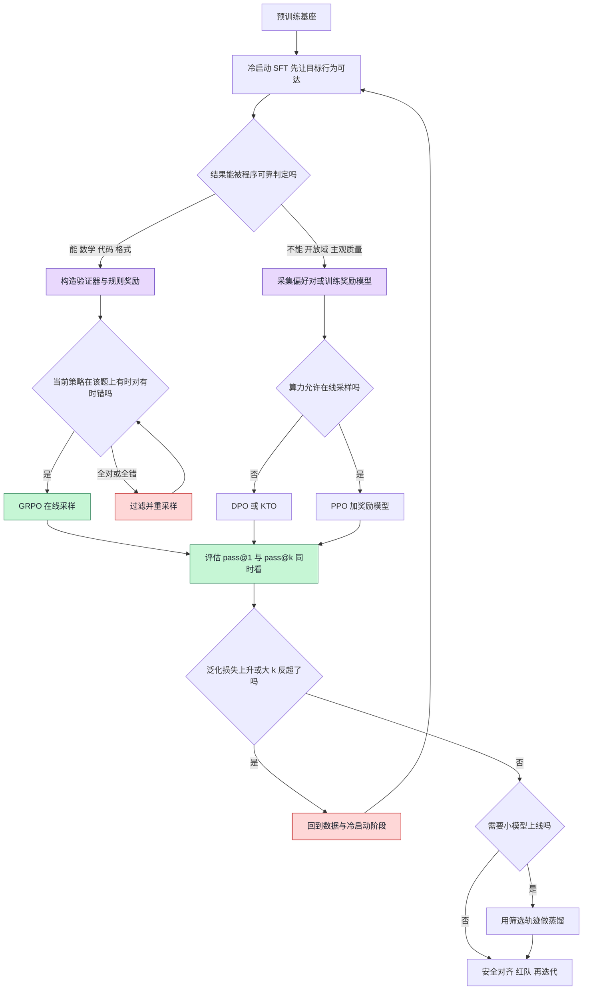
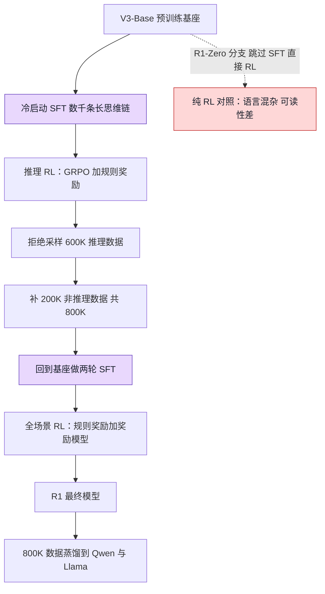

把后训练理解成「预训练结束后接一段 SFT，再做一次 RLHF」，在 2026 年已经会看错绝大多数公开流水线。DeepSeek-R1 的正式配方里 SFT 至少出现两轮，强化学习被拆成推理与全场景两段，中间夹着一次 80 万条的拒绝采样；而 R1-Zero 那条「纯 RL、全程不做 SFT」的路线，是作为能力验证的对照实验存在的，最终上线的模型反而要回到 SFT 去修可读性和语言混杂。

比流程更容易搞错的是层级。RLHF、RLVR、DPO、GRPO 常被并列成四种「后训练算法」，实际上 RLHF 与 RLVR 说的是奖励信号从哪来，PPO 与 GRPO 说的是拿到奖励后参数怎么更新，DPO 干脆不采样、也不做强化学习。层级摆错，「强化学习是否已经取代 SFT」这类问题就没有答案。

下面按四层坐标定概念，再拆两条数据路线，最后落到工程细节、能力边界和当前实际在跑的流水线。

<!--more-->

## 一、先定坐标：什么算后训练

判据只有一条：**这一步改不改模型权重**。预训练之后一切继续更新参数的训练都属于后训练，包括监督微调、偏好优化、强化学习、蒸馏和安全对齐。推理时计算（更长的思维链、多次采样投票、树搜索）不改参数，因此不是后训练。

这里有个容易被引文带偏的地方：ACL 2025 的《A Survey of Post-Training Scaling in Large Language Models》把 SFT、RLxF 和 Test-time Compute 并列为三大方向。那篇综述讨论的是「预训练边际收益下降之后，算力往哪投」，TTC 属于推理侧的扩展方向，并不是训练环节。把它读成「后训练包含推理时计算」，后面所有分类都会乱。

比罗列方法更有用的，是把方法拆到四个正交的层上：

| 层 | 问的问题 | 取值 |
|---|---|---|
| 轨迹来源 | 训练样本从哪来 | 外部示范（off-policy）／模型自采样（on-policy） |
| 监督接口 | 信号以什么形式给出 | token 目标／偏好对／标量奖励／教师输出分布 |
| 奖励来源 | 分数由谁判定 | 人类偏好奖励模型／规则验证器／AI 评委 |
| 优化算法 | 参数怎么更新 | 极大似然／DPO 闭式解／PPO／GRPO |

2026 年的统一综述《Large Language Model Post-Training: A Unified View of Off-Policy and On-Policy Learning》正是把「轨迹来源」提到顶层轴：off-policy 学外部轨迹，on-policy 学当前策略自己生成的 rollout，两者作用于不同瓶颈——前者扩张「有效支撑」，让原本采样不到的行为变得可达；后者在已经可达的区域里重塑分布。这个区分比损失函数的形式更根本，因为它决定了优化时能看到哪些状态，也就决定了哪些错误会被真正暴露出来。

用这四个层去给常见名词归位，很多争论会直接消失：

| 名词 | 所在层 | 真正解决的问题 | 常被误当成 |
|---|---|---|---|
| SFT | 轨迹来源 + 监督接口 | 让指令跟随、格式、工具调用等行为变得可达 | 已被 RL 淘汰的老方法 |
| 偏好数据 | 监督接口 | 表达「同一个问题哪个答案更好」 | 一种算法 |
| RLHF | 奖励来源 + 训练框架 | 用人类偏好训练奖励模型，再据此做 RL | 与 GRPO 并列的算法 |
| RLVR | 奖励来源 | 用程序可判定的结果代替主观打分 | 一种算法 |
| DPO | 优化算法（off-policy） | 跳过奖励模型与在线采样，直接拟合偏好 | 强化学习 |
| PPO / GRPO | 优化算法（on-policy） | 把奖励转成策略梯度 | 奖励设计 |
| LoRA / QLoRA | 参数更新方式 | 降低单次微调的显存与算力 | 与 SFT 同层的方法 |
| 蒸馏 | 监督接口（教师引导） | 把能力跨模型迁移 | 量化、剪枝一类的压缩 |
| 安全训练 | 数据 + 评估环节 | 约束行为边界 | 上线前的一次性检查 |

三个最常见的错位：把 RLHF、RLVR、GRPO 说成三条并列的强化学习路线；把 DPO 算作强化学习（它没有环境、没有 rollout、没有奖励模型，是在固定偏好对上做分类式优化）；把蒸馏和模型压缩混为一谈（蒸馏换的是模型，压缩改的是同一个模型的表示精度）。

## 二、两条路线：外部示范与自身采样

### off-policy：把别人的轨迹写进权重

SFT 做的是最朴素的极大似然：给定 prompt 和标准回答，逐 token 提高该回答的概率。它的价值不在「教会模型说话」，而在扩张有效支撑——如果基座模型几乎不可能采样出一条完整正确的解题链，RL 在稀疏的 0/1 奖励下根本收不到正样本，训练无从开始。指令跟随、输出格式、工具调用的参数结构、领域术语与代码风格，也都属于这一层：先把行为变得可达，才谈得上把行为变好。

偏好优化是在此之上的分布重塑。DPO（Rafailov 等，NeurIPS 2023）用 Bradley-Terry 模型把奖励函数消掉，直接得到策略上的闭式损失，只需要一个 chosen/rejected 对和一个冻结的参考模型；KTO（ICML 2024）进一步放宽到单条的「好／坏」二元反馈；RLAIF 源自 Anthropic 的 Constitutional AI（2022），用模型依一组自然语言原则自评来替代人工标注。这条线上的工程趋势是不断减少需要同时驻留的模型份数：从 RLHF 的四份（策略、参考、奖励、价值）到 DPO 的两份，再到 SimPO、ORPO 去掉参考模型。

蒸馏在坐标里属于「教师引导的监督接口」，而不是压缩。R1 的蒸馏模型是用教师生成的 80 万条样本，对小参数量的 Qwen2.5 与 Llama3 系列做 SFT；量化、剪枝改的是同一个模型的数值表示，两者不是一回事。蒸馏也不一定只在收尾做，它可以出现在流水线的任意阶段，甚至本身就是一次 SFT。

### on-policy：让模型暴露自己的错误

强化学习的差别只有一句：样本由当前策略自己生成，因此优化直接作用在模型真实会访问的状态上。SFT 看到的是「理想答案」，RL 看到的是「模型实际会写错的那些中间步骤」。同一个 prompt，前者把标准答案的概率推高，后者把模型自己生成的一批答案分出高下。

GRPO（Shao 等，DeepSeekMath，arXiv:2402.03300）是 PPO 的变体。PPO 需要一个与策略规模相当的价值模型（critic）估计每个 token 的基线，GRPO 改成对同一 prompt 采样 G 个回答，用组内统计量当基线：

```
A_i = (r_i - mean(r_1..r_G)) / std(r_1..r_G)
```

更新仍沿用 PPO 的裁剪目标，KL 惩罚项从奖励里挪进损失函数。省掉的是 critic，**不是打分器**：DeepSeekMath 仍用奖励模型给组打分，R1-Zero 则用规则验证器。把「GRPO 不需要奖励模型」当成结论，是复现时最直接的一次翻车。

原文实验配置是 G=64、KL 系数 0.04，在 7B 模型上把 GSM8K 从 82.9% 提到 88.2%、MATH 从 46.8% 提到 51.7%；R1-Zero 用 G=16；当前 TRL 的 GRPOTrainer 默认 G=8、KL 系数 0，默认损失类型已经是 DAPO。这些默认值差异意味着「照论文复现 GRPO」和「调库里的 GRPO」根本不是一回事，对比结果前先查配置。

## 三、横评：代价、信号与失效模式

| | SFT | DPO | PPO + 奖励模型 | GRPO + 验证器 |
|---|---|---|---|---|
| 轨迹来源 | 外部 | 外部偏好对 | 自采样 | 自采样，每组 G 条 |
| 监督信号 | token 目标 | 相对偏好 | 学习到的标量奖励 | 规则或奖励模型打分 |
| 驻留模型 | 策略 | 策略 + 参考 | 策略 + 参考 + 奖励 + 价值 | 策略 + 参考 + 打分器 |
| 单条样本成本 | 1 次前向 | 2 次前向 | 1 次生成 + 打分 | G 次生成 + G 次打分 |
| 主要作用 | 扩张可达行为 | 在已有行为里塑形 | 在已有行为里塑形 | 在已有行为里塑形 |
| 典型失效 | 覆盖不到模型自己会犯的错 | 受限于偏好数据里已有的答案 | 奖励模型被钻空子、critic 难训 | 零优势组、熵塌缩、长度偏置 |
| 适用 | 冷启动、格式、领域适配 | 风格与安全对齐、算力受限 | 开放域主观质量 | 数学、代码、可判定任务 |

一句可以记住的取舍：off-policy 决定「模型能走到哪」，on-policy 决定「在能走到的地方更常走哪条」。两者不是替代关系，代价也不同——GRPO 的算力花在 G 倍 rollout 上，省下的 critic 显存通常又还给了更大的组。

## 四、决策树：从基座模型出发怎么选



决策树的判断顺序是有意为之：先问验证器，再问难度带，最后才问算法。多数跑不出效果的 RL 项目不是算法选错，而是第一问就答不上来，却硬套了一个 0/1 奖励。

## 五、工程细节：真正决定成败的五件事

### 1. 验证器比算法重要

RLVR 的前提不是「有标准答案」，而是「判定过程能被程序可靠复现，且不容易被绕过」。可用形态包括：数学最终答案精确匹配、代码单测在沙箱里执行、格式与 schema 检查、Lean 一类定理证明器接受与否。R1-Zero 只用两类规则奖励——答案正确性与思维链标签格式，刻意不上神经奖励模型，理由正是大规模 RL 下奖励模型容易被钻空子。开放域写作、价值判断没有这样的验证器，硬造一个 0/1 代理指标，模型优化的只会是这个代理指标本身。

### 2. 全对与全错的题不产生梯度

组内奖励全相同时标准差为 0，所有 advantage 都是 0：这条 prompt 消耗了 G 次生成和打分，权重却一点没动，等价于悄悄缩小有效 batch。DAPO（字节 Seed 与清华 AIR，arXiv:2503.14476）的动态采样会过滤掉这类组，一直采到批次里全是 0 < 组内通过率 < 1 的题。

由此得到一条可执行的数据准则：**难度必须相对当前策略测量，且会随训练漂移**。太简单的题训一轮后就变成零优势组，太难的题从头到尾都是。数据侧实验也支持这个方向：固定标注预算下，把额度投给基座模型做不对的题，收益明显高于投给简单题。Qwen 团队挑选推理 RL 的 3995 条 prompt 时给的标准是「对冷启动模型可学，且尽可能难」，正是这个窗口。给全量题库打一次静态难度标签，然后一直用下去，是最常见的浪费。

### 3. 熵塌缩、长度偏置与截断噪声

朴素 GRPO 在规模化时有几个已成共识的坑：

- PPO 式对称裁剪会压制低概率的探索性 token，策略熵单调下降，模型越来越不敢试新路径；DAPO 的 clip-higher 把上下界解耦，取下界 0.2、上界 0.28。
- 先按序列平均再按批次平均的 token 损失，会让长回答里每个 token 的权重被稀释，模型在不确定时学会「写长」；改成批次级 token 平均，Dr. GRPO 则进一步去掉长度归一化与标准差项。
- 超长被截断的回答本就得不到可靠的最终奖励，直接判 -1 是往梯度里灌噪声，应做过滤，或在接近长度上限时给平滑惩罚。

DAPO 用这几项把 Qwen2.5-32B 在 AIME 2024 上从朴素 GRPO 的 30 分推到 50 分，训练步数只有对照的一半。改动大多不涉及优化器，改的是「哪些样本进组、怎么打分、怎么聚合」——这也是 2026 年后训练工程的主战场。

### 4. SFT 分数高，不等于 RL 后更强

ICLR 2026 的《Quagmires in SFT-RL Post-Training》用数百个参数量最大 12B 的模型、超过 100 万 GPU 小时、7 个数学基准最多 256 次重复，给出了成体系的反例：SFT 分数高的 checkpoint 不能可靠预测 RL 后的表现，某些情况下在 SFT 增强过的模型上做 RL，最终还不如直接在基座上做 RL。原因不复杂——SFT 分数偏爱简单、同质、反复训练的数据，而这类数据恰好压缩了 RL 需要的探索空间。同一个预算下，只用短样本训练分数更好看，RL 后却更差；半量数据训两轮往往优于一轮全量。

可执行的替代指标是留出推理样本上的泛化损失，加上大 k 的 pass@k；论文报告这两项对 RL 结果的预测精度（R² 与 Spearman 相关）比直接用 SFT 分数最多提升 0.5。结论该反过来写：**冷启动 SFT 的目标不是把 SFT 分数刷高，而是给 RL 准备一个还保留探索余量的初始化。**把 SFT 团队和 RL 团队各自按自己的 benchmark 考核，本身就是流水线设计缺陷。

### 5. 安全与评估是循环，不是收尾

安全数据微调、红队测试、对抗训练、提示注入与隐私检查，和前面所有阶段共享同一套数据构造能力。实际流程是「发现问题 → 构造数据 → 训练 → 评估 → 再训练」的闭环，而不是上线前做一次的合规检查；R1 把有用性与无害性奖励直接放进最后一轮 RL，也是这个思路。

## 六、能力边界：RLVR 提升的常常只是采样效率

这是 2025 年以来最该被写进任何一篇后训练文章的反直觉结论。NeurIPS 2025 最佳论文亚军（清华自动化系宋士吉、黄高团队）用大 k 的 pass@k 系统比较了基座模型与 RLVR 模型：小 k 时 RL 模型明显更强，k 增大到几十、上百后，基座模型稳定反超；RLVR 模型生成的推理路径基本都落在基座模型的采样分布内。当前主流 RLVR 做的是**分布锐化**——把基座本来就会、但概率不高的正确路径提到高概率位置，代价是解题空间变窄。PPO、GRPO、Reinforce++ 在这项比较里差异很小，都远未用满基座的潜力；反倒是蒸馏能从教师那里引入新的推理模式，真正扩张能力边界。

但结论有明确边界，写成「RL 没用」就过了。论文自己的说明指出，这适用于 0/1 稀疏奖励、且 GRPO 一类不带价值网络的设定：基座一次都采样不到正确答案时，奖励恒为 0，梯度也就恒为 0，探索自然无从发生。它指向的是几条仍开放的路——稠密或过程奖励、更细的信用分配、环境与数据的规模化与课程、跳出 token 级采样的探索机制、多轮 agent 交互。

这也解释了为什么「从模仿答案转向强化学习」这个趋势该加个注脚：转向的是**奖励信号的来源**（从人工示范变成可验证的结果），而不是「模型从此靠自己长出新能力」。能力上限目前仍主要由基座和蒸馏决定。

## 七、现在实际在跑的流水线

DeepSeek-R1 技术报告给出的不是三段式，而是交替的多阶段：

- **R1-Zero 分支**：V3-Base 直接上 GRPO，无 SFT，只有准确率与格式两类规则奖励；AIME 2024 pass@1 从 15.6% 提升到 70% 以上，多数投票到 86.7%，期间自发出现反思与回溯。但它混用语言、可读性差，因此只作为能力验证。
- **R1 正式分支**：数千条高质量长思维链做冷启动 SFT → 大规模推理 RL（追加语言一致性奖励）→ 用中间模型拒绝采样出 60 万条推理数据，再补 20 万条非推理数据，共 80 万条 → 回到 V3-Base 做两轮 SFT → 最后一轮全场景 RL，推理题用规则奖励、非推理题用奖励模型，并叠加有用性与无害性奖励。
- **蒸馏分支**：用这 80 万条直接 SFT Qwen2.5 与 Llama3 系列，32B 蒸馏模型在多项推理基准上超过 o1-mini。



把这条流水线按常见的六环节清单对齐，六个环节都在，但关系是网状的：数据构造贯穿全程（冷启动数据、RL 的 prompt、拒绝采样数据、偏好对、安全数据各是一套）；SFT 出现多次；偏好对齐与强化学习在不同阶段分别用规则奖励和奖励模型；蒸馏既是交付手段也是数据源；安全与评估从 RL 奖励项一直延伸到上线前红队。

三大趋势到这里可以给出更准确的表述：

**奖励来源从人转向可验证规则。** 变的是打分方式，不是 RL 变得更聪明。适用边界由验证器决定，所以数学、代码、结构化输出先受益，开放域仍依赖奖励模型与偏好数据。

**训练对象从单轮回答转向多步任务。** Agentic RL 把一次 rollout 拉长成几十步工具调用与环境交互，瓶颈随之变成信用分配：末尾一个 0/1 奖励无法指出第几步出错。2026 年的工作集中在把奖励降到步级或轮级（GiGPO 的组内再分组、原子轮次信用分配、验证器到轮次的信用回传），以及让环境、任务、验证器一起迭代——失败可能来自工具实现有 bug 或验证器判错，而不是策略差。当 rollout 接近百万 token 量级，公开讨论的共识是竞争点在训练稳定性与信用分配，而不是再发明一个新损失函数。

**数据与过程自动化，但验证器成了新的稀缺资源。** 教师生成、验证器筛选、拒绝采样 SFT、再 RL，构成可循环的自动闭环；循环里最贵的不再是标注，而是可复用、可信、不会被优化漏判的任务环境与判定规则。奖励劫持不是假想风险，长时程 agent 训练里已经观察到模型自发利用评测集与代理指标的行为。

2026 年的统一视角把这套组合总结为三种职能：支撑扩张、策略重塑、行为固化。SFT 与蒸馏负责把行为变得可达并固化下来，RL 与偏好优化负责在可达区域里重塑分布；多阶段流水线的意义，是让三种职能各自在最合适的时机执行，而不是指望一个目标函数包办。

## 八、写在最后

后训练的核心问题已经从「用哪个算法」变成「在哪个阶段、针对哪个瓶颈、用哪一层的方法」。把 SFT 和 RL 当成新旧两代技术，或者把 RLHF、RLVR、GRPO 排成一张算法清单，都会错过真正的变化：一条可用的流水线里 SFT 反复出现，验证器比优化器更值得投入，评估指标决定优化方向，而 RL 当前最确定的贡献是把基座已有的能力更高效地取出来。

两个判断值得留着：一是「RL 取代 SFT」在公开的产品配方里从未发生，R1 的正式分支比 R1-Zero 更依赖 SFT；二是「RL 让模型自主进化出新能力」在 0/1 可验证奖励下尚未被证实，pass@k 的曲线把这一点画得很清楚。下次看到一份后训练报告宣称能力跃升，先问三个问题：验证器判的是什么、训练前后 pass@k 怎么变、SFT 分数是被当作目标还是被当作诊断量。

## 参考资料

- Ouyang et al. *Training Language Models to Follow Instructions with Human Feedback*. 2022. arXiv:2203.02155
- Bai et al. *Constitutional AI: Harmlessness from AI Feedback*. 2022. arXiv:2212.08073
- Rafailov et al. *Direct Preference Optimization: Your Language Model is Secretly a Reward Model*. NeurIPS 2023. arXiv:2305.18290
- Ethayarajh et al. *KTO: Model Alignment as Prospect Theoretic Optimization*. ICML 2024. arXiv:2402.01306
- Shao et al. *DeepSeekMath: Pushing the Limits of Mathematical Reasoning in Open Language Models*. 2024. arXiv:2402.03300
- Lambert et al. *Tulu 3: Pushing Frontiers in Open Language Model Post-Training*. 2024. arXiv:2411.15124
- DeepSeek-AI. *DeepSeek-R1: Incentivizing Reasoning Capability in LLMs via Reinforcement Learning*. 2025. arXiv:2501.12948
- Yu et al. *DAPO: An Open-Source LLM Reinforcement Learning System at Scale*. 2025. arXiv:2503.14476
- Liu et al. *Understanding R1-Zero-Like Training: A Critical Perspective*. 2025. arXiv:2503.20783
- Lai et al. *A Survey of Post-Training Scaling in Large Language Models*. ACL 2025. ACL Anthology: 2025.acl-long.140
- Yue et al. *Does Reinforcement Learning Really Incentivize Reasoning Capacity in LLMs Beyond the Base Model?*. NeurIPS 2025. arXiv:2504.13837
- Kang et al. *Quagmires in SFT-RL Post-Training: When High SFT Scores Mislead and What to Use Instead*. ICLR 2026
- Zhao et al. *Large Language Model Post-Training: A Unified View of Off-Policy and On-Policy Learning*. 2026. arXiv:2604.07941
