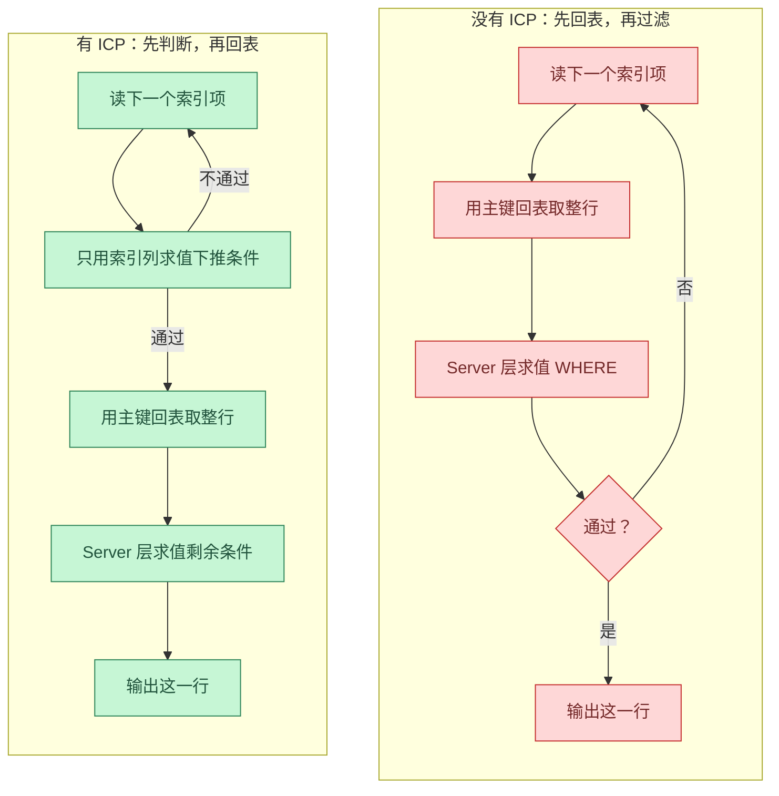
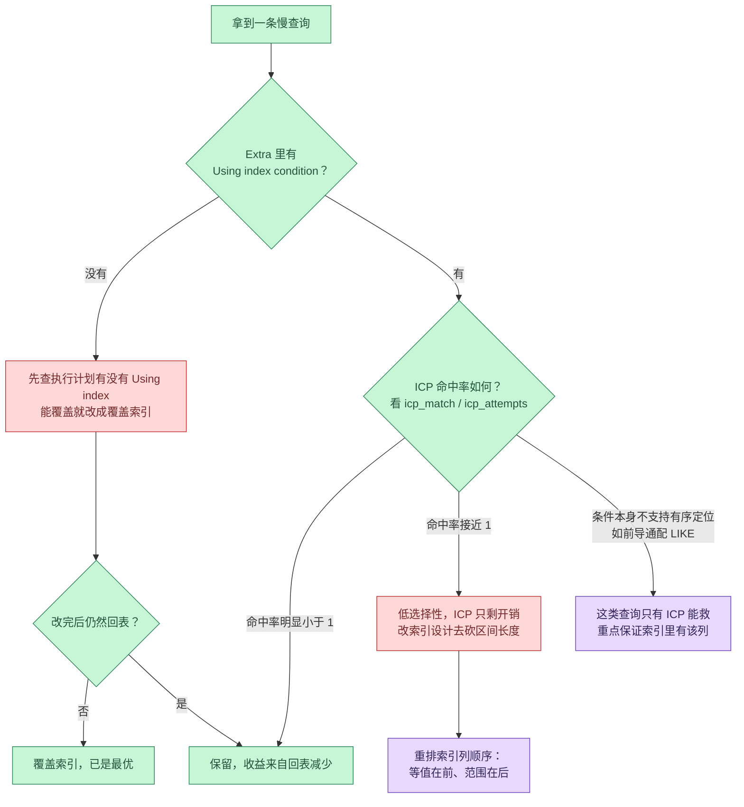

回表是二级索引查询绕不开的一笔开销。索引只能告诉引擎「符合条件的记录大概在哪一页」，要拿到记录本身还得按主键再查一次聚簇索引，而这次查询通常是随机 I/O。索引条件下推（Index Condition Pushdown，ICP）就是为这件事设计的：把能用索引列判断的 WHERE 条件提前交给存储引擎，在回表之前先过一遍。

本文以 5.6 引入 ICP 为起点，把 InnoDB 里一次下推判断的执行路径拆开讲；所有执行计划、计数器和耗时数据都在 MySQL 8.0.46 上用一个 200 万行的订单表实测得到，脚本可直接复现。涉及版本差异的地方（`EXPLAIN ANALYZE` 需要 8.0.18+、虚拟生成列需要 5.7+）会单独标注。

<!--more-->

## 一、先把三个容易混在一起的概念分开

讨论 ICP 之前，有三件事经常被搅成一团，但它们解决的问题完全不同。

**回表**：二级索引里存的是「索引列的值 + 主键值」，不是完整行。要拿到其他列，必须拿主键去聚簇索引再查一次，这次查询就叫回表。

**覆盖索引**：如果查询要的所有列恰好都在二级索引里，回表这一步根本不需要发生。`Using index` 标记的就是这种情况。

**索引条件下推**：回表无法避免时，退一步——让存储引擎在扫索引的过程中就用索引列把行筛一遍，只有通过筛选的记录才值得回表。

MySQL 官方手册对 ICP 的定义是一句话：用索引取行时，如果 WHERE 条件的一部分只依赖索引列就能求值，Server 层就把这一部分推到存储引擎；引擎先用索引项算出结果，满足了才去读基表行。手册明确写了它的目标是**减少读完整行的次数**，而不是减少扫描索引的次数。这个区别是全文最关键的一句话，后面所有的收益数字和边界条件都从它推出来。



两条链路唯一的差别是：判断动作从「取完整行之后」挪到了「取完整行之前」。挪动本身不改变判断的总次数，改变的是**有多少次随机 I/O 需要为被判死的记录买单**。

## 二、ICP 省的是哪一笔账

一次二级索引查询的成本可以拆成两笔：

| 成本项 | 由什么决定 | ICP 能否改善 |
| --- | --- | --- |
| 索引项扫描 | 索引列上的等值 / 范围条件能切出的连续区间有多长 | 不能 |
| 整行读取（回表） | 通过条件筛选、需要取完整列的记录数 | 能，且这是唯一的着力点 |

实测数据把这件事量化得非常干净。查询条件是「某城市 + 用户号区间 + 金额小于阈值」，建在 `(city, user_id, amount)` 上：

```sql
-- 索引区间由 city 与 user_id 切出，共 16000 个索引项
SELECT * FROM orders
 WHERE city = '深圳'
   AND user_id <= 800
   AND amount < 1200;
```

| 指标 | ICP 开启 | ICP 关闭 |
| --- | --- | --- |
| `Extra` | `Using index condition` | `Using where` |
| 送入 Server 的索引记录数 | 2410 | 16000 |
| ICP 判断次数 | 16001 | 0 |
| ICP 判定命中 / 未命中 | 2410 / 13590 | — |
| 实际耗时（同一轮三次采样） | 8.38 / 8.45 / 8.29 ms | 49.9 / 48.7 / 47.5 ms |

16000 个索引项被扫过这件事没有变——`Innodb_ICP_attempts` 的增量正好是 16001（多出的 1 是区间末尾那次越界检查），和 ICP 关闭时完全一致。变的是另一笔账：整行读取从 16000 次降到 2410 次，耗时差了约 5.8 倍。

这也解释了为什么 ICP 在执行计划里是「隐形的」：`EXPLAIN` 估算的 `rows` 只反映索引区间大小，两种模式下它都停在同一量级（29568 与 29568），不会因为 ICP 而变小。想判断 ICP 到底省了多少，只能看回表计数器，不能看 `rows`——这一点后面还会展开。

## 三、执行边界：什么能下推，什么不能

手册列出的适用条件是一份相当克制的清单，逐条实测下来如下。

**访问类型**：只有 `range`、`ref`、`eq_ref`、`ref_or_null` 这四种需要读完整行的访问方式才可能用到 ICP。

**引擎与索引层级**：InnoDB 与 MyISAM 都支持（含分区表）；对 InnoDB 而言**只用于二级索引**。聚簇索引本来就整行读进来了，下推判断省不下 I/O，反而多一层开销。

**不能下推的条件**：

| 条件类型 | 为什么 |
| --- | --- |
| 引用子查询 | 引擎层没有子查询的执行语义 |
| 引用存储函数 | 引擎不能调用存储函数 |
| 触发器产生的条件 | 同上，触发器逻辑不在引擎内 |
| 虚拟生成列上的二级索引 | 手册明确列为不支持，实测确认（见下文实验四） |
| 引用系统变量的派生表条件 | 8.0.30 起被排除在优化之外 |

**实测出的几条边界**：

```sql
-- 多表 JOIN 的内层表照常下推，JOIN 条件也在下推条件里
SELECT o.* FROM users_dummy u STRAIGHT_JOIN orders o
  ON o.user_id = u.uid
 WHERE o.city = '深圳' AND o.amount < 1200;
```

```sql
-- OR 组合的条件在 8.0 上可以下推
SELECT * FROM orders FORCE INDEX (idx_city_channel)
 WHERE city = '深圳' AND (channel LIKE '%e%' OR channel LIKE '%o%');
```

```sql
-- 索引列上包了函数：索引区间用不上这个条件，但 ICP 仍能逐条求值
SELECT * FROM orders
 WHERE city = '深圳' AND user_id <= 800 AND ABS(amount) < 1200;
```

第三条最容易被误判成「索引失效」。区分方法很明确：`ABS(amount) < 1200` 让 `amount` 无法参与区间定位，所以索引区间只剩 `city` 和 `user_id`；但 ICP 判断拿得到 `amount` 的值，于是照常在索引项上把它算掉——实测判断次数 16001、命中 2410，与直接写 `amount < 1200` 完全一致，耗时 15.9 ms 对 17.2 ms。索引失效是「定位阶段用不上」，ICP 存续是「筛选阶段还能救」，两者不是一回事。

还有一个反例值得单独记，下面这条查询在执行计划里同样显示 `Using index condition`：

```sql
SELECT * FROM orders
 WHERE city = '深圳'
   AND user_id <= 800
   AND amount < (SELECT 1200 FROM DUAL);
```这不是子查询能被下推，而是这个不查任何表的子查询在优化阶段就被折叠成了常量 1200，等价于常量比较。手册说的「引用子查询的条件不能下推」依然成立，别拿这种例子去证明相反的结论。

## 四、一次下推判断在 InnoDB 里发生了什么

Server 层把下推条件封装成一个布尔表达式交给 handler，InnoDB 侧保存在 `ha_innobase::pushed_idx_cond` 上。扫到每条索引记录时，InnoDB 调用 `innobase_index_cond()` 求值，它只有三种返回值：

```cpp
ICP_RESULT innobase_index_cond(ha_innobase *h) {
  if (h->end_range && h->compare_key_icp(h->end_range) > 0) {
    /* caller should return HA_ERR_END_OF_FILE already */
    return ICP_OUT_OF_RANGE;
  }
  return h->pushed_idx_cond->val_int() ? ICP_MATCH : ICP_NO_MATCH;
}
```

- `ICP_MATCH`：条件成立，继续取整行
- `ICP_NO_MATCH`：条件不成立，丢掉这条索引记录，直接看下一条
- `ICP_OUT_OF_RANGE`：当前记录已经越过范围边界，整段扫描可以收尾

第三个返回值是很多人不知道的部分：ICP 不只会过滤，还能**提前结束扫描**。命中它的时候，记录缓冲区被标记为越界，扫描循环直接返回 `DB_RECORD_NOT_FOUND`，不必再把剩下的索引项走完。

真正执行判断的 `row_search_idx_cond_check()` 里有两处细节值得注意：

```cpp
for (i = 0; i < prebuilt->idx_cond_n_cols; i++) {
  /* Convert to MySQL format those fields that are needed for
  evaluating the index condition. */
  row_sel_store_mysql_field(mysql_rec, prebuilt, rec, ...);
}
```

第一，它只把**下推条件用到的那些列**从 InnoDB 的记录格式转换成 MySQL 格式，不多转换一个字节。转换顺序也做了安排：如果命中且需要回表，剩余字段要等到聚簇索引记录取回来之后再转。

第二，同一段代码里留着一条注释，提醒二级索引上大小写不敏感列的历史数据可能让 ICP 判断结果不正确——同一列在不同记录里大小写不一致时，索引里的排序和比较语义与 Server 层不同。这类坑平时不出问题，出问题时极难定位。

顺带一提，数据字典表（`mysql.*`）在 handler 里被显式关掉了 ICP，源码注释写明原因是历史上 ICP 在这些表上出过问题。

## 五、EXPLAIN 里怎么读这三个标记

`Extra` 列里与 ICP 相关的三个标记，语义和共现关系是这样的：

| 标记 | 含义 | 是否需要回表 |
| --- | --- | --- |
| `Using index condition` | 有部分条件下推到了引擎，在索引项上先判 | 需要 |
| `Using where` | Server 层还要再判一次剩余条件 | 不一定 |
| `Using index` | 覆盖索引，整行不必读 | 不需要 |

实测中出现的四种组合：

| 查询形态 | `Extra` | 含义 |
| --- | --- | --- |
| 全部条件都能下推 | `Using index condition` | Server 层没有残留条件 |
| 部分条件能下推 | `Using index condition; Using where` | 引擎挡掉大部分，Server 再补一刀 |
| 覆盖索引 | `Using where; Using index` | 不回表，条件全在 Server 层判 |
| 什么都不优化 | `Using where` | 条件全留在 Server 层 |

关于这四个组合，有几条流传很广的说法需要纠正：

1. **「出现了 `Using index condition` 就等于查询变快了」**——不成立。判断本身有 CPU 开销，条件筛不掉多少行时它是净成本。实测里 `amount < 9900` 这个条件只挡掉 16000 条里的 109 条，ICP 开着和关着的耗时落在同一个噪声区间。
2. **「覆盖索引和 ICP 是一回事」**——完全不是两回事。实测覆盖索引那一组的 ICP 判断次数是 **0**，它靠的是根本不回表，不需要过滤。
3. **「有 `Using where` 就说明 ICP 没生效」**——错，两者会共存。前者是「Server 层还有活要干」，不是「引擎没干活」。
4. **「`Extra` 里不出现 `Using where`，说明条件都下推了」**——在实测里成立（`ABS(amount)` 那组），但这是间接证据，引擎判断是否生效仍要看计数器。
5. **「ICP 会减少扫描行数，所以 `rows` 会变小」**——实测里 `rows` 估算不受 ICP 影响，扫描的索引项数一分没少。
6. **「ICP 对全表扫描也有用」**——全表扫描没有回表可省，实测判断次数为 0，`Extra` 只有 `Using where`。

## 六、实测：200 万行订单表上的六组对照

**环境**：MySQL 8.0.46，InnoDB Buffer Pool 256 MB，表 `orders` 共 200 万行（数据 120.66 MB，索引 252.25 MB），三个二级索引。Buffer Pool 小于数据总量，保证回表请求会真的打到磁盘，而不是全变成内存读。

```sql
CREATE TABLE orders (
  id          BIGINT UNSIGNED NOT NULL AUTO_INCREMENT,
  user_id     INT UNSIGNED    NOT NULL,
  city        VARCHAR(16)     NOT NULL,
  status      TINYINT         NOT NULL,
  amount      INT             NOT NULL,
  channel     VARCHAR(16)     NOT NULL,
  v_year      INT GENERATED ALWAYS AS (YEAR(created_at)) VIRTUAL,
  created_at  DATETIME        NOT NULL,
  PRIMARY KEY (id),
  KEY idx_city_user_amount (city, user_id, amount),
  KEY idx_city_channel (city, channel),
  KEY idx_city_v_year (city, v_year)
) ENGINE=InnoDB;
```

六组对照的汇总（耗时为同一轮三次采样的中位值，缓存状态一致）：

| 组 | 查询要点 | `Extra` | 送入 Server 的索引记录数 | ICP 判断 / 命中 | 耗时 |
| --- | --- | --- | --- | --- | --- |
| 一 | `amount < 1200` | `Using index condition` | 2410 | 16001 / 2410 | 8.38 ms |
| 二 | 同上，ICP 关闭 | `Using where` | 16000 | 0 | 48.7 ms |
| 三 | 覆盖索引 | `Using where; Using index` | 16000 | 0 | 7.20 ms |
| 四 | 前导通配 `LIKE` | `Using index condition` | 66666 | 100000 / 66666 | 194 ms |
| 五 | 虚拟生成列索引 | 无 | 100000 | 0 | 269 ms |
| 六 | 低选择性条件 | `Using index condition` | 15891 | 16001 / 15891 | 波动大 |

**组三（覆盖索引）**是最值得反复看的一组。查询要的列都在索引里，回表彻底消失，ICP 判断次数为 0，耗时 7.20 ms 反而比开启 ICP 的组一（8.38 ms）还略快。结论很直接：**能做成覆盖索引就不要指望 ICP**，ICP 是覆盖索引做不到时的次优解。

**组四（前导通配）**是 ICP 最不可替代的场景：

```sql
SELECT * FROM orders FORCE INDEX (idx_city_channel)
 WHERE city = '深圳' AND channel LIKE '%e%';
```

`LIKE '%e%'` 没法用来定位索引区间，索引只能切出 `city = '深圳'` 的 10 万条记录。如果没有 ICP，这 10 万条全部要回表再由 Server 层过滤。开启 ICP 后引擎在索引项上就把 `channel` 算掉了，只有 66666 条回表，耗时从 273 ms 降到 194 ms。这类「条件本身不支持有序定位、又必须读整行」的查询，是 ICP 唯一无可替代的地方。

**组五（虚拟生成列）**验证了手册那条限制。条件 `v_year = 2024` 命中 10 万行，执行计划里既没有 `Using index condition` 也没有 `Using where`，ICP 判断次数为 0，10 万行全部回表，耗时 269 ms。用虚拟列加索引来做「按年份过滤」看起来是个不错的写法，实际上放弃了 ICP 这一层保护。

**组六（低选择性）**是本文的反直觉结论。把条件放宽到 `amount < 9900` 之后，ICP 只挡掉 16000 条里的 109 条，命中 15891 条，回表从 16000 降到 15891——收益不到 1%。此时开启 ICP 相当于白做了 16001 次判断。三次采样的耗时分别是 49.4 / 57.6 / 65.9 ms（开启）和 72.8 / 73.6 / 82.6 ms（关闭），两组方差都很大、彼此交叠，**因此不能宣称「ICP 一定更快」，只能说「这种情况下 ICP 不亏、也不赚」**。判断 ICP 有没有价值，看的是命中率，不是执行计划里有没有那个标记。

## 七、观测 ICP：四个计数器怎么开，坑在哪

想验证 ICP 到底判断了多少次，能用的是 InnoDB 的四个计数器。开启它们的过程有两个坑，都实测踩过。

**坑一：`SHOW STATUS` 里没有它们。**

```sql
SHOW STATUS LIKE '%ICP%';
-- Empty set
```

网上流传的「查 `Innodb_ICP_attempts`」在 8.0 上查不到任何结果。这些计数在 `information_schema.INNODB_METRICS` 里，而且默认状态是 `disabled`，计数为 0。

**坑二：必须逐个赋值，逗号列表会被拒绝。**

```sql
SET GLOBAL innodb_monitor_enable = 'icp_attempts';
SET GLOBAL innodb_monitor_enable = 'icp_match';
SET GLOBAL innodb_monitor_enable = 'icp_no_match';
SET GLOBAL innodb_monitor_enable = 'icp_out_of_range';

SELECT name, count, status
  FROM information_schema.INNODB_METRICS
 WHERE name LIKE 'icp%';
```

写成 `'icp_attempts,icp_match,...` 会直接报 `ERROR 1231`。另外注意 5.x 用的是 `innodb_metrics` 这个变量，到 8.0 拆成了 `innodb_monitor_enable` / `innodb_monitor_disable` / `innodb_monitor_reset` / `innodb_monitor_reset_all` 四个。

**坑三：reset 变量对这几个计数器无效，只能做差。** 下面这条执行后，读出来的值没有任何变化。

```sql
SET GLOBAL innodb_monitor_reset = 'icp_attempts';
```它们是全局累计计数，压测时又有并发干扰，唯一可靠的做法是查询前后各读一次、自己减：

```sql
SELECT count AS before_count
  FROM information_schema.INNODB_METRICS WHERE name = 'icp_attempts';

-- 跑目标查询（注意：EXPLAIN ANALYZE 会真实执行语句，也会累加计数）

SELECT count AS after_count
  FROM information_schema.INNODB_METRICS WHERE name = 'icp_attempts';
```

至于回表次数，`Handler_read_next` 是更稳定的会话级计数器，它的口径是**送入 Server 层的索引记录数**。ICP 开着时这个数等于真正回表的行数（实测 2410），关着时等于扫过的索引项数（实测 16000）；覆盖索引那一组是 16000，因为它一条也没筛，16000 条索引记录全部交给了 Server 层。全表扫描时该计数器不动，动的是 `Handler_read_rnd_next`（实测 2000316，约等于全表行数）。用会话级计数器看回表量，用 InnoDB 计数器看判断量，两个口径配合着看，才能说清一次查询到底花了什么。

## 八、什么时候 ICP 是答案，什么时候不是

把 ICP 放回工具箱，和几个常一起出现的手段对照：

| 手段 | 减少什么 | 适用前提 | 代价 |
| --- | --- | --- | --- |
| 覆盖索引 | 回表 | 查询列可被某棵索引覆盖 | 索引变宽，写入变慢 |
| ICP | 回表 | 有回表，且有条件能只用索引列求值 | 逐条判断的 CPU |
| MRR | 回表的随机性 | 引擎支持，成本模型判定划算 | 排序缓冲 |
| 函数索引 / 生成列索引 | 区间定位能力 | 8.0.13+ 或 5.7 生成列 | 索引数量和维护成本 |
| 调整索引列顺序 | 区间定位能力 | 条件里等值列在前 | 重建索引 |

几个反直觉的组合值得单独说清楚：

- **覆盖索引优先于 ICP**。组三实测 7.20 ms 对组一的 8.38 ms，前者还不做判断。
- **函数索引优先于 ICP**。当条件写成 `YEAR(created_at) = 2024` 这类形式，能把表达式变成索引列是根治；ICP 只能在逐条扫描时救，遇到 10 万行就是 10 万次判断。
- **MRR 和 ICP 不冲突**。MRR 把回表请求排序后批量读，ICP 从源头减少回表次数，一个管「顺序」一个管「数量」。本文没有对两者叠加做测量，这里只做逻辑判断。
- **把等值列放到范围列前面**，能让条件进入索引区间定位，ICP 就不必为它花判断成本——这是索引设计层面直接改变 ICP 收益的手法。



## 九、写在最后

ICP 干的事很小：把过滤动作从「取完整行之后」挪到「取完整行之前」，用内存里的整数比较换掉一次随机 I/O。它不减少扫描量，也不改变执行计划的形状，所以在监控里很容易被忽略——但一次 16000 次回表压到 2410 次，就是 5 倍以上的差距。

三条可以直接落地的准则：

1. **判断 ICP 有没有用，看回表次数和命中率，不看执行计划上有没有那个标记。** `Extra` 里的 `Using index condition` 只说明引擎接了活，接得值不值要看 `icp_match` 占 `icp_attempts` 的比例。
2. **先把覆盖索引的可能性排除掉。** 回表能被彻底消除的时候，ICP 是多余的。
3. **ICP 救不了索引设计的毛病。** 等值列被范围列挡在后面、条件写成索引列上的表达式、大量数据落在同一个值上导致选择度崩坏——这三种问题的正解都在索引定义上，ICP 只是在后面追着补。

真正需要 ICP 的场景其实很窄：必须读整行、条件只能逐条判断、而且能筛掉足够多的行。前导通配的模糊匹配、命中即弃的日志式查询，都是它的主场。