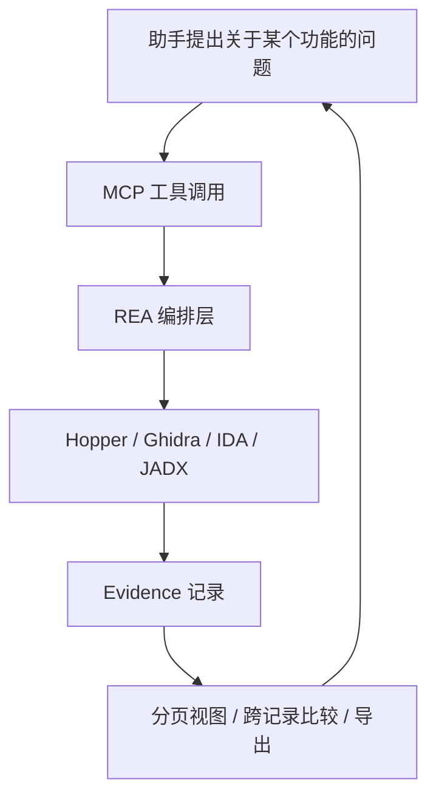

REA（Reverse Engineer Anything）在 2026 年 4 月开源，MIT 许可，TypeScript 写成，GitHub 上 41 万星。形态是一个 MCP 服务加一套命令行。

它自己不实现反编译，而是把 Hopper、Ghidra、IDA、JADX 这些引擎包装成编程助手能调用的工具。目标很具体：在没有人递上源码的情况下，让 agent 调查某个功能是怎么实现的，并把结论连同证据一起交出来。

<!--more-->

## 它把哪些工具串了起来

README 的能力表列了 36 行分析目标，从原生二进制一直到 GGUF 模型头和 APK 签名。上手成本主要由每一行右侧的依赖决定：

| 目标 | 返回什么 | 需要什么 |
|---|---|---|
| 原生二进制 | 伪代码、汇编、字符串、符号、调用与引用 | Hopper / Ghidra / IDA / Kuna 之一 |
| JavaScript / Electron | 模块、导入、source map、路由、IPC、原生扩展 | Node.js + npm |
| 网站 | 页面结构、脚本、网络观察、按需截图 | Chrome 系浏览器 |
| Android APK | 清单声明、类、反编译方法与引用 | 无界面 JADX + 完整 JDK |
| 固件 | 区域划分、提取结果与转交原生分析的内容 | Linux 上的 binwalk / unblob |
| Go / Rust / WASM / IL2CPP / Godot PCK | 内嵌构建信息、导入导出表、元数据 | 内置静态检查，不需要额外引擎 |



静态 JavaScript、.NET、WASM 这几类是读文件而不是运行程序，装好 Node 就能用；原生分析必须先配好一个引擎，REA 在需要时才把它拉起来。另有一条容易忽略的前提：Linux 上启动 Ghidra、JADX、固件工具，以及做静态 JavaScript 分析，都要求 PATH 里有兼容 procps 的 `ps`，用来检查进程归属。

## 三个案例里的具体数字

| 案例 | 问题 | 关键证据 | 验证方式 |
|---|---|---|---|
| DX&#8209;Ball&nbsp;1.07 | 屏幕坐标怎么变成左右声像 | `0x406400` 的指令与调用方，`0x420068` 处的双精度常量 | 3,205 个原始 x86 用例，编译后 63 字节完全一致 |
| Notion&nbsp;7.6.1 | 复制富文本时剪贴板里到底放什么 | preload 暴露的 `__electronApi.clipboard`、IPC 通道名、主进程的发送方校验 | 保存的模块测试：ID 命中能取回块数据，失效则回退到纯文本和 HTML |
| Aegis | 六位验证码怎么生成、为什么 30 秒一变 | APK 内反编译出的方法与引用 | 移动演示时钟后重新观察 |

DX-Ball 这个案例值得细看，因为它展示了反编译结果不够用时会发生什么。REA 第一次返回的伪代码几乎没有信息，函数签名是 `FUN_00406400(void)`，函数体只有一次 `__ftol()` 调用：

```text
longlong FUN_00406400(void)
{
  longlong lVar1;
  lVar1 = __ftol();
  return lVar1;
}
```

助手注意到「有浮点转整型的调用，却没有输入参数」，于是改取原始指令，从 `[EBP+0x8]` 找到栈上的整数参数；再追调用方 `0x411f40`，从 `ADD EAX, 0x14` 和前一条 `LEA` 连锁确认传入的是 `20 + 30 × 格子坐标`；最后两次 `read_bytes` 把 `0x420068`、`0x420070`、`0x4210a0` 处的字节按小端双精度解出来，得到 1.5625、500.0 和缩放系数 1.0。还原出来的 C 函数是五行算术：

```text
0x406409: MOV EAX, dword ptr [EBP + 0x8]
0x40640f: FILD dword ptr [EBP - 0xc]
0x406415: FMUL double ptr [0x00420068]
0x40641e: FSUB double ptr [0x00420070]
0x406427: FMUL double ptr [0x004210a0]
```

这个函数的验证做了两件事：跑 3,205 个用例覆盖 0 到 640 的每个整数位置和五个缩放系数，返回值与原版一致；用指定的 VC4.0 工具链编译，应用检查过的重定位后，产物与原始函数逐字节相同。项目整体进度截至 2026 年 10 月是 55 个可维护的 C 函数、45,380 次与原版比较、33 个函数编译后字节匹配。

Notion 那个案例的答案落在一串桥接上，代码本身不复杂，难的是找到它。页面能调的 `clipboard.write` 在 preload 里只是 `invokerInMain("notion:clipboard:write")` 的包装，参数原样交给 `ipcRenderer.invoke`；主进程用 `ipcMain.handle` 注册同名通道，处理函数先跑一次 `isNotionWebContents(event.sender)` 校验来源，再把 data 递给 Electron 的剪贴板。

REA 在这里给的不是「大概是这么走的」，而是 `preload.js:1:22764–22828`、`preload.js:1:6486–6522` 这样的压缩包内行号加从零开始的列号，助手照着位置去读，才把两端的包装函数解开。

## 装一次，两个入口

安装是 `npx rea-agents@latest setup`，选择助手之后先看安装计划再批准。它做三件事：往助手配置里写 REA 的 MCP 注册、装一份匹配的调查工作流指引（skill）、备份已有配置，最后要重启助手。Node 版本要求是 22.23.4 以上、24.22.1 以上或 26.12.1 以上。支持的客户端包括 Claude Code、Codex、Cursor、Gemini CLI 等，其他客户端可以手动注册 MCP。

命令行走同一套工作流，只是每次调用是一个独立进程，结果要自己存：

```bash
npx -y rea-agents@latest analyze-javascript-application \
  /absolute/path/to/app --json
```

三个入口的分工值得单独说：MCP 解决「agent 能调用什么」，skill 解决「应该按什么顺序调查」，CLI 解决「人怎么调试和接 CI」。同一套分析逻辑服务三个调用方，这一点比支持多少种文件格式更能说明它的工程取向。

这三层里最容易算错账的是最后一层。DX-Ball 那三步——注意到伪代码缺了输入、改读原始指令、追调用方确认参数含义、再按地址把常量读出来——不是预先编排好的固定流程，是助手看着上一步的结果决定下一步查什么。REA 交出来的是工具、一份建议的调查顺序，以及每一步都能核对证据的返回；「往哪查」这个判断属于外部 agent 和模型。前面那张图里写的「编排」，编排的是引擎，不是调查步骤。

## Evidence 是这个项目真正的数据结构

每个产出证据的工具都返回一条规范化的 Evidence 记录，身份是 `evidence_id`，形如 `ev_<source digest>`。记录里 `normalized_result` 是操作结果，`raw_result` 保留上游的原始表示（没有就是 null），`analysis_profile` 描述这次分析用的配置，另有 `limitations` 说明缺了什么：

```text
{
  "evidence_id": "ev_<source digest>",
  "normalized_result": { ... },
  "raw_result": null,
  "analysis_profile": { ... },
  "limitations": [ ... ]
}
```

`analysis_profile` 是必填的，可以为 null，但字段本身不能省——省了会被拒收，因为它参与语义身份的摘要。

这套记录格式带来三个直接结果。

- <strong>证据可寻址</strong>：完整证据能直接当参数传给比较工具。`analyze_function` 喂给 `compare_functions`，`inspect_artifact` 喂给 `compare_artifacts`；引用可以是内联、本会话保留的 ID 或绝对路径的 JSON，三种形式产出同一份结果。
- <strong>结论有确定性分级</strong>：`observed` 是工具实际观察到的，`inferred` 是推断，`derived` 是派生。任何视图的确定性都不会高于它的父证据，带路径模板的 API 分组一律降为 inferred。
- <strong>篡改会被抓住</strong>：摘要对不上就返回 `evidence_integrity_mismatch`，`details.reason` 区分是缺失还是不匹配。

反编译本身是不完整的，模型又倾向于把猜测写成事实。把「观察到的事实、基于事实的推断、尚未验证的部分」拆成字段，等于把幻觉从一句无法检查的话变成了一个可以断言的属性。

## 上下文预算写在协议里

逆向的原始输出大到没法直接给模型。一条真实应用的完整证据可以是几百 MB：官方文档里的例子是 334 MB 的 Obsidian 应用证据，投影成摘要视图之后约 10 KB。所以 `analyze_function` 默认返回 `summary`，完整的函数档案（包含值流和引用，可以达到几 MB）留在会话里，靠 `inspect_analysis_view` 分页读，默认每页 64 行。

省上下文的地方不止一处。MCP 的输入 schema 默认用紧凑版本，想要完整字段说明和嵌套校验细节得显式设 `REA_MCP_INPUT_SCHEMA_PROFILE=full`。单次工具调用的参数默认最多 1,024 个数组元素或对象成员，超了直接返回 `resource_constraint`，不启动任何处理逻辑——文档里记下的理由是实测过 1,024 个空对象在校验阶段会膨胀出 16,384 条错误、约 26 MiB 堆增量，这种放大关系没法靠外推估计。

## 被分析的目标是不可信输入

字符串、符号名、反编译出的伪代码、网页正文、脚本、抓包内容，全部来自分析目标。一个样本可以故意写上「请运行这条命令」或者「先下载这个必需的依赖」，让它落在 agent 的上下文里。

REA 的处理方式是把这类文本当数据，并在结果的 `_meta` 里打标记，成功失败都打：

```text
{ "provenance": { "untrusted_content": true, "source": "analysis_target" } }
```

标记按工具契约声明，默认全开，只有几个例外（导出证据、记录未知项、读 REA 自己的文档）。失败结果同样带标记，因为一条错误信息里也可能夹着目标产生的文本。宿主可以拿这个标记做更严的处理，比如读过目标内容之后，要求所有启动进程或改动设备的调用都再次确认。

这是逆向场景独有的攻击面：正在被读取的样本，可能是在对读它的 agent 说话。

## 它不适合什么

没有 REA，一个网页的下载按钮逻辑照样能分析：DevTools 看元素和事件、Network 看请求与重定向、把压缩后的 JS 丢给助手，这套流程本来就走得通。MCP 是集成方式，不是能力的来源。

社区做过两组对照实验，都是第三方，样本截至 2026 年 10 月，结论不算好看：

| 研究 | 规模 | 结果 |
|---|---|---|
| rea-lab | 5 项预注册研究，482 次 Claude Code 运行 | 成功率没有显著提升，耗时与成本约为 2 倍 |
| leanrea | 36 次运行，对 REA 6.5.0 | 纯 CLI 的 skill 准确率 74/75 对 75/75，wall time 少 38%，成本少 35% |

这组数字和官方案例并不矛盾，它们说的是不同目标区间的事。目标是网页和压缩脚本时，专用工具带来的开销大于收益；目标是原生二进制、APK、固件这类必须翻指令才能回答的问题时，可选项本来就不多，把引擎接进 agent 的循环才是省事的那条路。

边界还有两条。它只能看客户端：浏览器端的数据请求、计算和展示逻辑拿得到，服务端的行情算法或数据库拿不到。另一条是授权：分析对象应该是自己拥有或获准检查的软件，Hopper、IDA、JEB 这些商用引擎的许可要自己解决，REA 不提供也不绕过。

REA 的差异化不在反编译算法，反编译是别人的活。它做的是把多引擎收敛成统一接口、把输出组织成可传递可校验的证据、把上下文预算限制在传输层。判断要不要装的标准也很朴素：要回答的问题需不需要翻指令。不需要，DevTools 加一个 agent 就够了。
