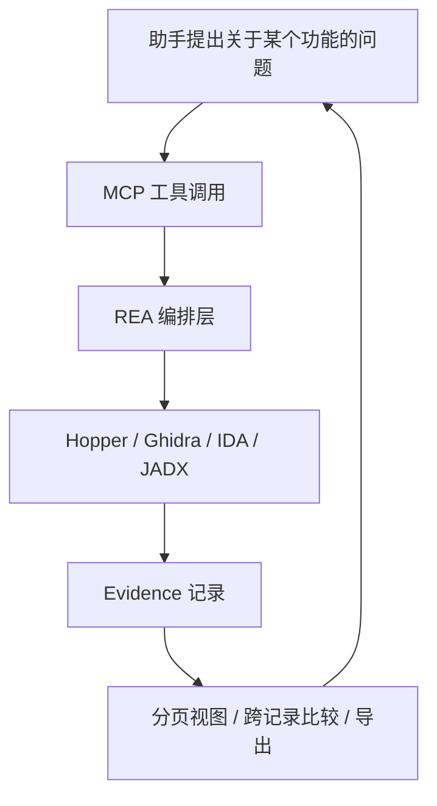

REA（Reverse Engineer Anything）在 2026 年 4 月开源，MIT 许可，TypeScript 写成，形态是一个 MCP 服务加一套命令行。

它不重新发明反编译算法。真正做的是把 Hopper、Ghidra、IDA、JADX 这些已有的逆向引擎包装成编程助手能调用的工具，让 AI 在没有源码的情况下，像工程师一样一步步调查某个功能是怎么实现的，并把结论连同可核对的证据一起交出来。

<!--more-->

## 它接了哪些引擎

README 的能力表列了 36 行分析目标，从原生二进制一直到 GGUF 模型头和 APK 签名。上手成本主要由每一行右侧的依赖决定：

| 目标 | 返回什么 | 需要什么 |
|---|---|---|
| 原生二进制文件 | 伪代码、汇编、字符串、符号、调用与引用 | Hopper / Ghidra / IDA / Kuna 之一 |
| JavaScript&nbsp;/&nbsp;Electron | 模块、导入、source map、路由、IPC、原生扩展 | Node.js + npm |
| 网站页面 | 页面结构、脚本、网络观察、按需截图 | Chrome 系浏览器 |
| Android&nbsp;APK | 清单声明、类、反编译方法与引用 | 无界面 JADX + 完整 JDK |
| 固件镜像文件 | 区域划分、提取结果与转交原生分析的内容 | Linux 上的 binwalk / unblob |
| Go&nbsp;/&nbsp;Rust&nbsp;/&nbsp;WASM&nbsp;/&nbsp;IL2CPP | 内嵌构建信息、导入导出表、元数据 | 内置静态检查，不需要额外引擎 |

静态 JavaScript、.NET、WASM 这几类是读文件而不是运行程序，装好 Node 就能用；原生分析必须先配好一个引擎，REA 在需要时才把它拉起来。另有一条容易忽略的前提：Linux 上启动 Ghidra、JADX、固件工具，以及做静态 JavaScript 分析，都要求 PATH 里有兼容 procps 的 `ps`，用来检查进程归属。

## 原理是编排，不是反编译

REA 的原理不在它自己能反编译得多好——反编译是 Hopper、Ghidra 这些引擎的活。它做的是另外两件事：把引擎的调用与输出包装成统一的 MCP 工具和规范化记录；把一次调查拆成一串由模型驱动的工具调用。



这个循环的关键，是每一步返回什么、下一步查什么，都交给调用方决定。以原生二进制为例：助手先要某个函数的伪代码；伪代码信息不足，就改读原始指令；发现参数来源不明，再追调用方；遇到常量，按地址把字节读出来解析。这是一条由观察驱动的调查链，不是预先写死的流程。

REA 交出来的是工具、一份建议的调查顺序，以及每一步都能核对的证据；「往哪查」属于外部 agent 和模型。上面那张图里写的「编排」，编排的是引擎，不是调查步骤。

## 为什么做成 MCP

同一套分析逻辑通过三个入口暴露：MCP 服务让 agent 能调用工具，附带的 skill 规定按什么顺序调查，命令行给人调试和接 CI。三者共用同一个内核，这一点比支持多少种文件格式更能说明它的工程取向。

但 MCP 是集成方式，不是能力的来源。没有 REA，一个网页的下载按钮逻辑照样能用 DevTools 看元素、Network 看请求、把压缩后的 JS 丢给助手分析出来。MCP 的价值在于把引擎接进 agent 的调查循环，让模型在循环里逐步翻指令、追引用——对原生二进制、APK、固件这类必须翻指令才能回答的问题，可选项本来就不多，接进循环才是省事的那条路。

社区的两组第三方对照实验（样本截至 2026 年 10 月）给这件事浇了点冷水：

| 研究 | 规模 | 结果 |
|---|---|---|
| rea&#8209;lab | 5 项预注册研究，482 次 Claude Code 运行 | 成功率没有显著提升，耗时与成本约为 2 倍 |
| leanrea | 36 次运行，对 REA 6.5.0 | 纯 CLI 的 skill 准确率 74/75 对 75/75，wall time 少 38%，成本少 35% |

两组数字和官方案例并不矛盾，它们说的是不同目标区间：网页和压缩脚本这类目标，专用工具带来的开销大于收益；必须翻指令的目标，把引擎接进 agent 循环才划算。

## Evidence 证据模型

每个产出证据的工具都返回一条规范化的 Evidence 记录，身份是 `evidence_id`，形如 `ev_<source digest>`。记录里 `normalized_result` 是操作结果，`raw_result` 保留上游的原始表示（没有就是 null），`analysis_profile` 描述这次分析用的配置，另有 `limitations` 说明缺了什么：

```text
{
  "evidence_id": "ev_<source digest>",
  "normalized_result": { ... },
  "raw_result": null,
  "analysis_profile": { ... },
  "limitations": [ ... ]
}
```

`analysis_profile` 是必填的，可以为 null，但字段本身不能省——省了会被拒收，因为它参与语义身份的摘要。这套记录格式带来三个直接结果。

- <strong>证据可寻址</strong>：完整证据能直接当参数传给比较工具。`analyze_function` 喂给 `compare_functions`，`inspect_artifact` 喂给 `compare_artifacts`；引用可以是内联、本会话保留的 ID 或绝对路径的 JSON，三种形式产出同一份结果。Notion 那个案例给出的不是「大概是这么走的」，而是 `preload.js:1:22764–22828` 这样的压缩包内行号加从零开始的列号，助手照着位置去读，才把 preload 和主进程两端的包装函数解开。
- <strong>结论有确定性分级</strong>：`observed` 是工具实际观察到的，`inferred` 是推断，`derived` 是派生。任何视图的确定性都不会高于它的父证据，带路径模板的 API 分组一律降为 inferred。
- <strong>篡改会被抓住</strong>：摘要对不上就返回 `evidence_integrity_mismatch`，`details.reason` 区分是缺失还是不匹配。

反编译本身是不完整的，模型又倾向于把猜测写成事实。把「观察到的事实、基于事实的推断、尚未验证的部分」拆成字段，等于把幻觉从一句无法检查的话变成了一个可以断言的属性。

上下文预算也写在协议里。一条真实应用的完整证据可以是几百 MB：官方文档的例子是 334 MB 的 Obsidian 应用证据，投影成摘要视图之后约 10 KB。所以 `analyze_function` 默认返回 `summary`，完整的函数档案（包含值流和引用，可以达到几 MB）留在会话里，靠 `inspect_analysis_view` 分页读，默认每页 64 行。单次工具调用的参数默认最多 1,024 个数组元素或对象成员，超了直接返回 `resource_constraint`，不启动任何处理逻辑——文档里记下的理由是实测过 1,024 个空对象在校验阶段会膨胀出 16,384 条错误、约 26 MiB 堆增量，这种放大关系没法靠外推估计。

还有一条逆向场景独有的攻击面：正在被读取的样本，可能是在对读它的 agent 说话。字符串、符号名、反编译出的伪代码、网页正文、脚本、抓包内容，全部来自分析目标，一个样本可以故意写上「请运行这条命令」。REA 把这类文本当数据，并在结果的 `_meta` 里打标记，成功失败都打：

```text
{
  "provenance": {
    "untrusted_content": true,
    "source": "analysis_target"
  }
}
```

标记按工具契约声明，默认全开，只有几个例外（导出证据、记录未知项、读 REA 自己的文档）。失败结果同样带标记，因为一条错误信息里也可能夹着目标产生的文本；宿主可以拿这个标记做更严的处理，比如读过目标内容之后，要求所有启动进程或改动设备的调用都再次确认。

## 用 DX-Ball 还原一个声像函数

DX-Ball 1.07 要回答的问题是：屏幕坐标怎么变成左右声像。REA 第一次返回的伪代码几乎没有信息，函数签名是 `FUN_00406400(void)`，函数体只有一次 `__ftol()` 调用：

```text
longlong FUN_00406400(void)
{
  longlong lVar1;
  lVar1 = __ftol();
  return lVar1;
}
```

助手注意到「有浮点转整型的调用，却没有输入参数」，于是改取原始指令，从 `[EBP+0x8]` 找到栈上的整数参数；再追调用方 `0x411f40`，从 `ADD EAX, 0x14` 和前一条 `LEA` 连锁确认传入的是 `20 + 30 × 格子坐标`；最后两次 `read_bytes` 把 `0x420068`、`0x420070`、`0x4210a0` 处的字节按小端双精度解出来，得到 1.5625、500.0 和缩放系数 1.0。还原出来的关键指令是五行算术：

```text
0x406409: MOV EAX, dword ptr [EBP + 0x8]
0x40640f: FILD dword ptr [EBP - 0xc]
0x406415: FMUL double ptr [0x00420068]
0x40641e: FSUB double ptr [0x00420070]
0x406427: FMUL double ptr [0x004210a0]
```

这条链子把前面几节的东西全演示了一遍：工具调用是入口，逐步调查靠模型判断，每一步的返回都能当作证据核对。函数还原成五行算术后，验证做了两件事：跑 3,205 个用例覆盖 0 到 640 的每个整数位置和五个缩放系数，返回值与原版一致；用指定的 VC4.0 工具链编译，应用检查过的重定位后，产物与原始函数逐字节相同。项目整体进度截至 2026 年 10 月是 55 个可维护的 C 函数、45,380 次与原版比较、33 个函数编译后字节匹配。
